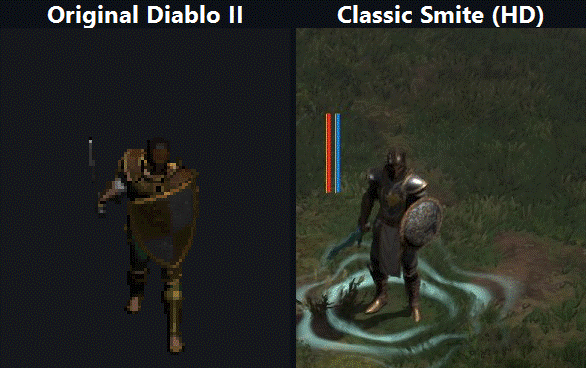
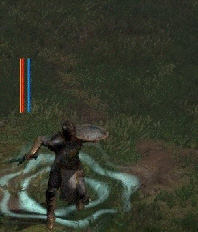

# Classic Smite

A [D2RMM](https://github.com/olegbl/d2rmm) mod for Diablo II: Resurrected that
makes the Paladin's Smite move like it did in original Diablo II. In the base
game's HD graphics, Smite is a hunch and an upward shove. With this mod the
Paladin winds up, steps forward with his right foot, and punches his shield
straight out with his sword raised, like the original sprite.



Left: the original Smite sprite, taken from the game files and facing the same
way. Right: Classic Smite in HD, captured in game at real speed. Each original
attack is timed to the HD one so both hits land together.

One Classic Smite in slow motion:



## What changes

- **The Smite animation**, in this order:
  1. The shield swings out and is pulled back by the left shoulder, with the
     sword held low.
  2. The right foot steps past the left foot and lands in front, and the body
     moves forward with it. The left foot stays planted.
  3. On the hit, the Paladin drops into a crouch and punches the shield arm
     straight out, with the sword raised over his head. He holds the crouch for
     a moment, like the original.
  4. The right foot steps back to where it started.

  The timing follows the original sprite frame by frame, and the hit lands when
  the game deals the damage.
- **Back-to-back Smites** blend into each other faster than in the base game
  (0.05 seconds instead of 0.2), so each one shows the step. Otherwise the blend
  covers most of the step at normal attack speeds.

Smite's damage, speed and hit timing don't change. The new animation is used
with one-handed swing weapons, daggers and no weapon. Legacy graphics (G) are
unchanged.

## Compatibility

The mod replaces the Paladin's whole HD animation file
(`hd\character\player\paladin\animation\combined.animations`). Other mods that
change Paladin animations conflict with it, and whichever installs last wins.
It also edits one value in `paladin_state_machine.json`, which works alongside
other mods that edit that file.

## Install

1. Download `ClassicSmite.zip` from the [latest release](../../releases/latest)
   and put the `ClassicSmite` folder in D2RMM's `mods` folder.
2. In D2RMM, enable **Classic Smite** and click **Install Mods**.
3. Restart the game if it's running.

To check it works, use Smite with a shield on. The Paladin steps forward and
punches the shield out.

Tested with D2RMM Custom 2.0.2, D2RLoader 1.3.1-beta and Diablo II:
Resurrected 3.3.93847.

## How it's made

The animation was built in Blender from key poses matched to the original
Smite sprite, frame by frame. The scripts are in [tools](tools):

- `casc.py` extracts the Paladin's model, skeleton and animations from the
  game, and `dcc.py` decodes the original Smite sprite to compare against.
- `export_clip.ps1` uses [LSLib](https://github.com/Norbyte/lslib) to export
  Smite as glTF for Blender.
- `make_smite.py` builds the animation in Blender.
- `splice.ps1` writes it back into the game's animation file. Besides the
  bones, it rewrites the clip's foot targets, which the game uses to plant the
  feet, and holds its aim point still. Without that, the game keeps the feet and
  the weapon arm on the original Smite's motion.
- `dcc_sync.py` and `make_compare_gif.ps1` make the comparison GIF above.

The game only shows the first 0.48 seconds of the clip per attack (12 frames at
Diablo II's 25 fps), so the whole move fits in that part.

They need LSLib's ExportTool, Blender 5, Python 3 and D2RMM's `CascLib.dll`.

## Build a release

```powershell
.\package.ps1
```

This writes `dist\ClassicSmite.zip`.

## License

MIT. See [LICENSE](LICENSE). The animation file in `ClassicSmite` is a modified
copy of the game's own. Diablo II: Resurrected is © Blizzard Entertainment.
